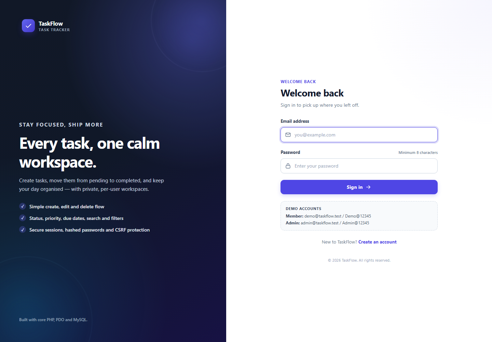
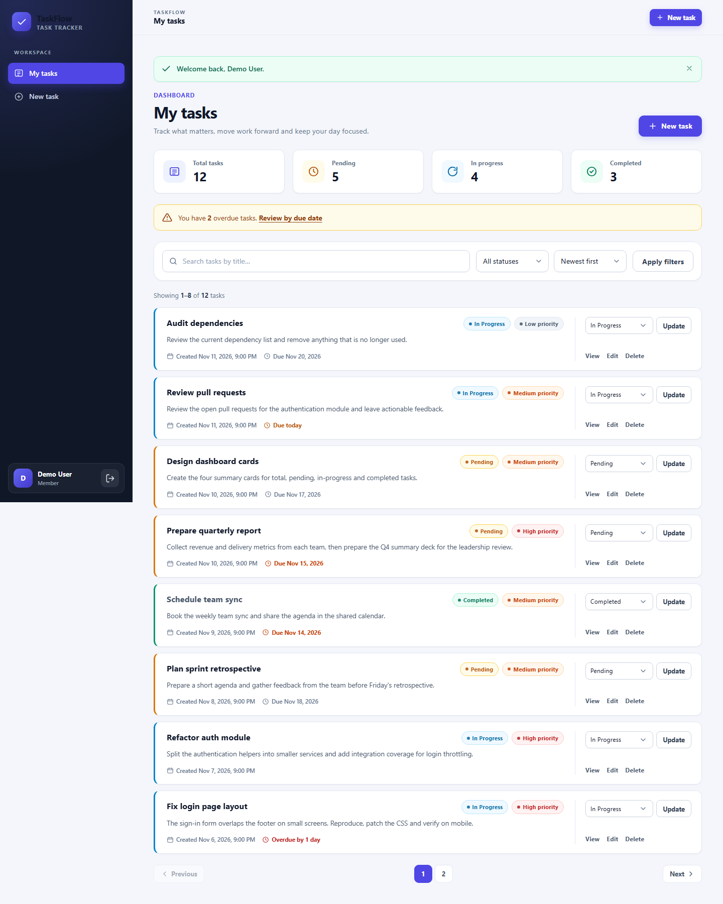
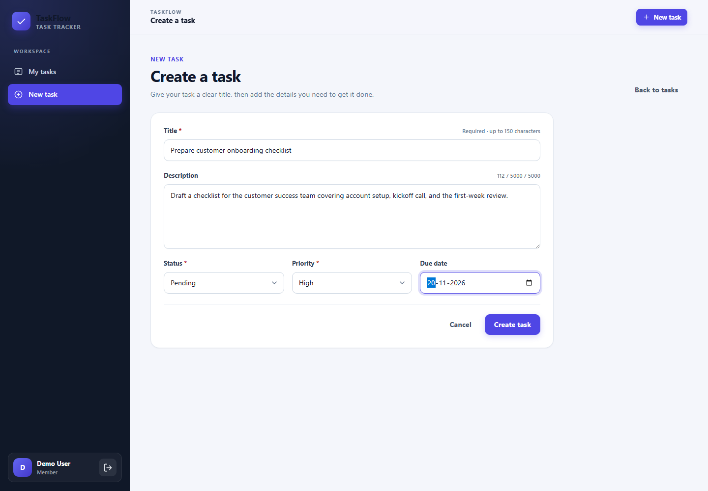
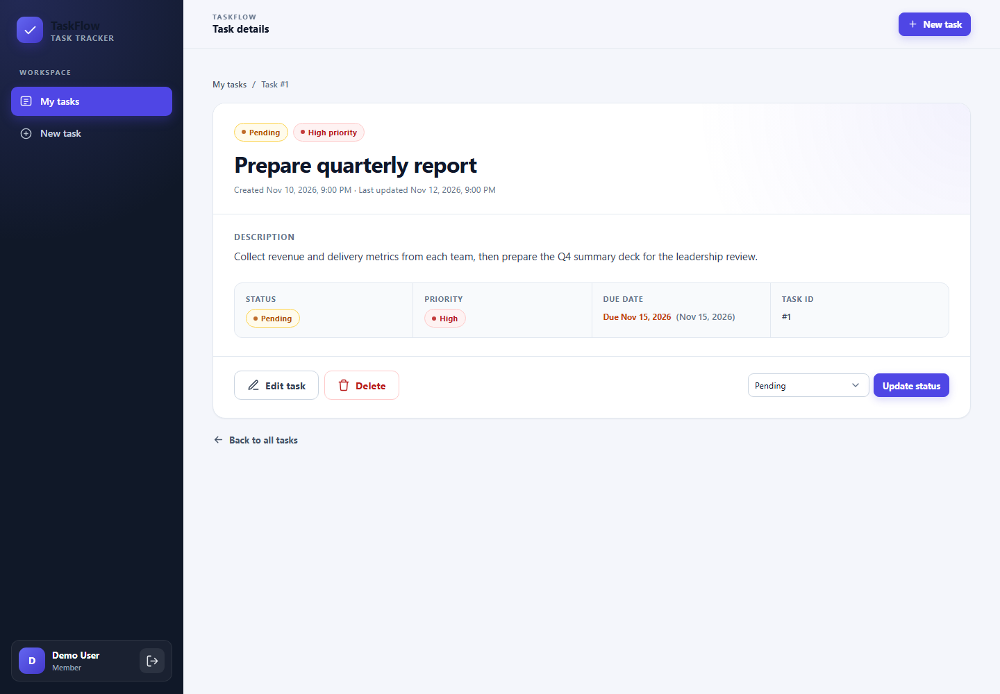
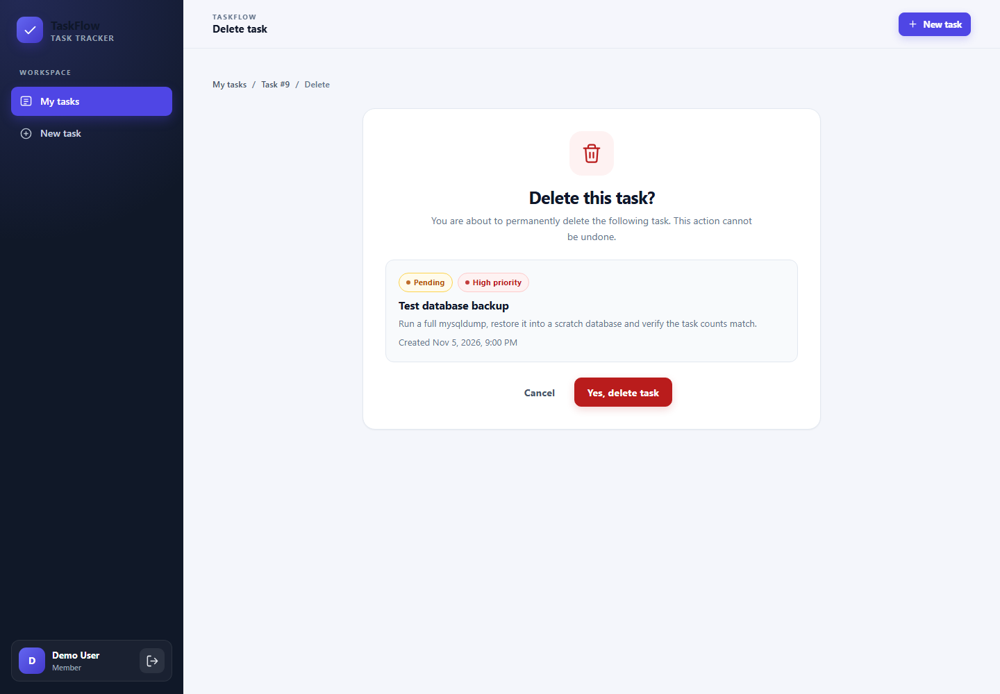
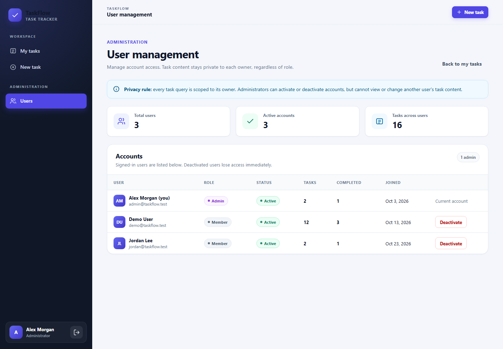
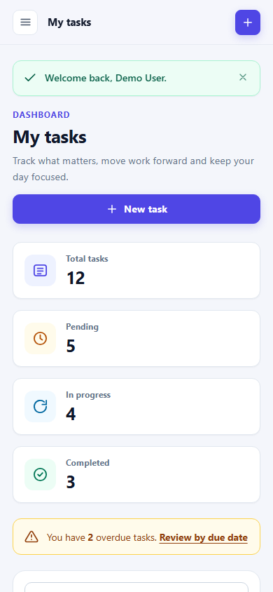

# TaskFlow — Task Tracker

A small, self-contained task tracker built with **PHP 8.1+ (PDO) and MySQL/MariaDB**. It covers the full
assignment brief: task CRUD, statuses, search/filter, authentication, per-owner authorization, CSRF
protection, server-side validation, plus optional bonuses (pagination, dashboard summary, priority and
due dates, sorting, admin account management).

No framework, no Composer packages, no CDN assets. Everything needed to run the app is in this folder.

---

## Contents

- [Feature overview](#feature-overview)
- [Screenshots](#screenshots)
- [Requirements](#requirements)
- [Setup](#setup)
- [Test accounts](#test-accounts)
- [Roles and privacy model](#roles-and-privacy-model)
- [Project structure](#project-structure)
- [Database schema](#database-schema)
- [Validation rules](#validation-rules)
- [Security implementation](#security-implementation)
- [Automated tests](#automated-tests)
- [Backup and restore](#backup-and-restore)
- [Configuration reference](#configuration-reference)
- [Known limitations](#known-limitations)
- [AI assistant disclosure](#ai-assistant-disclosure)

---

## Feature overview

### Level 1 — Task management
- Create a task with title and description.
- List all of the signed-in user's tasks.
- Edit a task's title and description.
- Delete a task through a dedicated confirmation page (no accidental deletes).
- Success and failure messages after every action.

### Level 2 — Status, search and filtering
- Statuses: **Pending**, **In Progress**, **Completed**.
- Change status directly from the dashboard or from the task detail page.
- Title search (case-insensitive `LIKE`, search wildcards treated literally).
- Status filter combined with search.
- Client-side hints **and** server-side validation for every form. Server-side rules are authoritative.

### Level 3 — Accounts and security
- Registration and login with `password_hash()` / `password_verify()`.
- Dashboard, tasks, and every task route require an authenticated session.
- Ownership is enforced in SQL (`WHERE id = ? AND user_id = ?`); other users' task IDs return **404**.
- Prepared statements everywhere (including the paginated list, filters, and sorting allowlist).
- All dynamic output is HTML-escaped through a single `e()` helper.
- CSRF token on every state-changing request, verified with `hash_equals()`.

### Bonus features
- Pagination (8 tasks per page, configurable) with filter-preserving page links.
- Dashboard summary cards: total, pending, in progress, completed, plus an overdue notice.
- Priority (low / medium / high) and optional due dates.
- Sorting: newest, oldest, title, due date, priority.
- Admin area: activate/deactivate accounts (admins cannot read other users' tasks).
- Responsive layout with a mobile navigation drawer and accessible form states.

---

## Screenshots

| Sign in | Dashboard |
|---|---|
|  |  |

| Create task | Task details |
|---|---|
|  |  |

| Delete confirmation | Admin — user management |
|---|---|
|  |  |



---

## Requirements

| Component | Version |
|---|---|
| PHP | 8.1 or newer, with `pdo_mysql` (developed and tested on PHP 8.4.27) |
| Database | MySQL 8.0+ or MariaDB 10.4+ |
| Web server | PHP's built-in server (for local use) or Apache with `mod_rewrite` |
| PHP extensions | `pdo_mysql`, `mbstring`, `json`, `session` |

The automated test suite also needs the `curl` extension.

---

## Setup

### 1. Place the project

Copy the project folder somewhere your web server can read, for example `D:\RTIH` or
`/var/www/taskflow`. The **document root must be the `public/` folder**, not the project root.

### 2. Create and import the database

`database.sql` creates the `task_tracker` database, the `users` and `tasks` tables, and sample data.

```bash
mysql -u root -p --default-character-set=utf8mb4 < database.sql
```

> **Warning:** the script drops and recreates `users` and `tasks`. Back up existing data first.
> Due dates in the sample data are relative to the import date, so the demo stays useful.

If your MySQL user cannot create databases, create `task_tracker` manually and import the script into it.
In phpMyAdmin, create the `task_tracker` database and use the **Import** tab to run `database.sql`.

### 3. Configure the environment

Copy the template and edit the values:

```bash
cp .env.example .env        # Windows: copy .env.example .env
```

```dotenv
APP_NAME="TaskFlow"
APP_ENV=local
APP_DEBUG=true
APP_URL=http://127.0.0.1:8000
APP_TIMEZONE=UTC

DB_HOST=127.0.0.1
DB_PORT=3306
DB_NAME=task_tracker
DB_USER=root
DB_PASSWORD=

SESSION_NAME=taskflow_session
SESSION_LIFETIME=7200
SESSION_SECURE=auto

LOGIN_MAX_ATTEMPTS=5
LOGIN_LOCKOUT_SECONDS=900
TASKS_PER_PAGE=8
```

Use `APP_DEBUG=false` and `APP_ENV=production` for anything public. `.env` is git-ignored on purpose.

### 4. Run the application

**Option A — PHP built-in server (simplest):**

```bash
php -S 127.0.0.1:8000 -t public public/router.php
```

Then open <http://127.0.0.1:8000>.

**Option B — Apache/XAMPP:**

1. Point a virtual host's `DocumentRoot` at the project's `public/` folder.
2. Ensure `mod_rewrite` and `AllowOverride All` are enabled; `public/.htaccess` routes requests to
   `public/index.php`.
3. Open the configured host in your browser.

Both options keep `app/`, `config/`, `storage/`, `.env` and `database.sql` outside the web root.

### 5. Run the test suite (optional)

See [Automated tests](#automated-tests). The suite creates its own `task_tracker_test` database and
temporary server, so it does not modify demo data.

---

## Test accounts

| Role | Email | Password |
|---|---|---|
| Member | `demo@taskflow.test` | `Demo@12345` |
| Member | `jordan@taskflow.test` | `Jordan@12345` |
| Admin | `admin@taskflow.test` | `Admin@12345` |

New accounts can be created from `/register`. Passwords must be at least 8 characters and are stored
with `password_hash($password, PASSWORD_DEFAULT)` (bcrypt). When `APP_ENV=local`, the login screen
shows the demo credentials to speed up review; they are never shown in production.

---

## Roles and privacy model

There are two roles:

- **Member (`user`)** — can create and manage only their own tasks.
- **Admin (`admin`)** — has all member abilities for their own tasks, plus an account list at
  `/admin/users` where accounts can be deactivated or reactivated.

**Task content is private to its owner for both roles.** Every query that reads, updates or deletes a
task includes `user_id` in the `WHERE` clause, and admin routes never join to task content. An admin
who requests another user's task receives the same **404** as any other stranger, so the app does not
reveal whether the task exists. Deactivating an account invalidates that user's existing sessions on
their next request; admins cannot deactivate their own account.

---

## Project structure

```text
RTIH/
├── app/
│   ├── bootstrap.php          # autoloader, env/config, security headers, session start
│   ├── Controllers/           # AuthController, TaskController, AdminController
│   ├── Core/                  # router, request, session, auth, CSRF, validator, view, DB
│   ├── Models/                # User, Task (all SQL lives here)
│   └── Support/helpers.php    # e(), url(), redirect(), flash helpers, status labels
├── config/config.php          # typed configuration loaded from .env
├── docs/
│   ├── screenshots/           # UI screenshots used by this README
│   └── TESTING.md             # test cases, results and bugs found/fixed
├── public/                    # web root (index.php, router.php, .htaccess, assets)
├── resources/views/           # layouts, auth pages, task pages, admin page, errors
├── routes/web.php             # all routes
├── storage/logs/              # writable log directory
├── tests/run_tests.php        # end-to-end integration suite (29 tests)
├── database.sql               # schema + sample data
├── .env.example               # configuration template
└── README.md
```

Request flow: `public/index.php` → bootstrap → router → controller → model (PDO) → view.
Controllers never contain SQL and views never contain queries.

---

## Database schema

### `users`

| Column | Type | Notes |
|---|---|---|
| `id` | `INT UNSIGNED` | primary key |
| `name` | `VARCHAR(100)` | display name |
| `email` | `VARCHAR(190)` | unique, stored lowercase |
| `password_hash` | `VARCHAR(255)` | bcrypt hash, never plain text |
| `role` | `ENUM('user','admin')` | default `user` |
| `is_active` | `TINYINT(1)` | deactivated accounts cannot sign in |
| `created_at`, `updated_at` | `TIMESTAMP` | automatic timestamps |

### `tasks`

| Column | Type | Notes |
|---|---|---|
| `id` | `INT UNSIGNED` | primary key |
| `user_id` | `INT UNSIGNED` | FK → `users.id`, `ON DELETE CASCADE` |
| `title` | `VARCHAR(150)` | required |
| `description` | `TEXT` | optional |
| `status` | `ENUM('pending','in_progress','completed')` | default `pending` |
| `priority` | `ENUM('low','medium','high')` | default `medium` |
| `due_date` | `DATE` | optional |
| `created_at`, `updated_at` | `TIMESTAMP` | automatic timestamps |

Composite indexes on `(user_id, status)`, `(user_id, created_at)` and `(user_id, due_date)` support
the dashboard filters and sorting without scanning the whole table. `ON DELETE CASCADE` removes a
user's tasks only if the account row itself is deleted; normal account removal is a deactivation.

---

## Validation rules

Server-side validation runs for every write; the values below are enforced in `TaskController` and
`AuthController` through `App\Core\Validator`.

| Form | Field | Rule |
|---|---|---|
| Task | `title` | required, max 150 characters |
| Task | `description` | optional, max 5000 characters |
| Task | `status` | required, one of `pending`, `in_progress`, `completed` |
| Task | `priority` | required, one of `low`, `medium`, `high` |
| Task | `due_date` | optional, real date in `YYYY-MM-DD` |
| Register | `name` | required, 2–100 characters |
| Register | `email` | required, valid email, max 190, unique |
| Register | `password` | required, 8–72 characters, must match confirmation |
| Login | `email` | required, valid email |
| Login | `password` | required, max 72 characters |

Invalid input re-renders the form with inline errors and the previous values (passwords are never
echoed back). Unknown statuses, sort keys and pages are clamped or rejected rather than reaching SQL.

---

## Security implementation

| Requirement | Implementation |
|---|---|
| Password storage | `password_hash()` / `password_verify()`, automatic rehash when the default algorithm changes |
| SQL injection | PDO prepared statements for every query; sort column chosen from a fixed allowlist |
| Ownership | `user_id` is part of every task `SELECT` / `UPDATE` / `DELETE`; foreign IDs return 404 |
| Authorization | `Auth::requireLogin()` in the task controller constructor; `Auth::requireRole('admin')` for admin routes |
| XSS | All dynamic output escaped with `e()` (`htmlspecialchars`, `ENT_QUOTES`, UTF-8) |
| CSRF | Random token per session, rotated on login/logout, verified with `hash_equals()` on all POSTs |
| Session security | HttpOnly, SameSite=Lax, `Secure` auto-detected, strict mode, regeneration on login/logout, 2-hour idle timeout |
| Login throttling | 5 failed attempts per email per session, 15-minute lockout, constant-time dummy hash for unknown accounts |
| Clickjacking / MIME | `X-Frame-Options: DENY`, `X-Content-Type-Options: nosniff`, `Referrer-Policy`, `Permissions-Policy` |
| Content Security Policy | `default-src 'self'`, no inline scripts/styles, no external CDNs |
| Redirects | Only local paths accepted after login/status updates (`safe_local_path()`), preventing open redirects |
| Error handling | Generic user-facing errors; details logged server-side only when debug is off |
| Account state | Deactivated accounts are rejected at login and on the next authenticated request |
| Enumeration | Login returns the same message for unknown emails and wrong passwords |

---

## Automated tests

The suite exercises the running application over HTTP with a real database and cookie jar.

**Prerequisites:** PHP with `pdo_mysql` and `curl`, and a MySQL server reachable through `.env`.

```bash
php tests/run_tests.php
```

What it does:

1. Creates and migrates a separate `task_tracker_test` database from `database.sql`.
2. Starts PHP's built-in server on `127.0.0.1:8099`.
3. Runs 29 end-to-end tests covering authentication, CSRF, validation, CRUD, status changes,
   search/filter/pagination, escaping, ownership, admin rules, throttling and HTTP error handling.
4. Drops the test database and stops the server even on failure.

Latest result:

```text
29 passed, 0 failed
```

The full list of test cases, the manual checklist and the bugs found during development are in
[`docs/TESTING.md`](docs/TESTING.md).

---

## Backup and restore

Use `mysqldump` for a consistent logical backup. The commands below work in Bash and PowerShell after
adjusting credentials.

**Back up:**

```bash
mysqldump -u root -p --single-transaction --routines --triggers \
  --default-character-set=utf8mb4 task_tracker > backup_task_tracker.sql
```

**Restore into an existing database:**

```bash
mysql -u root -p --default-character-set=utf8mb4 task_tracker < backup_task_tracker.sql
```

**Restore from scratch** (create the database first if the dump does not include `CREATE DATABASE`):

```bash
mysql -u root -p -e "CREATE DATABASE IF NOT EXISTS task_tracker CHARACTER SET utf8mb4 COLLATE utf8mb4_unicode_ci;"
mysql -u root -p --default-character-set=utf8mb4 task_tracker < backup_task_tracker.sql
```

Also copy `.env` and any uploaded files if you add them later. Verify a restore by signing in and
checking that the task count matches the dashboard summary. For a production schedule, run the dump
nightly (cron or Task Scheduler), keep several generations, and store copies off the application
server.

---

## Configuration reference

| Variable | Default | Purpose |
|---|---|---|
| `APP_NAME` | `TaskFlow` | Brand name in the UI |
| `APP_ENV` | `production` | `local` shows demo credentials on the login page |
| `APP_DEBUG` | `false` | Enables detailed errors (never enable in production) |
| `APP_URL` | `http://localhost:8000` | Canonical base URL |
| `APP_TIMEZONE` | `UTC` | PHP and display timezone |
| `DB_HOST` / `DB_PORT` | `127.0.0.1` / `3306` | Database endpoint |
| `DB_NAME` | `task_tracker` | Database name |
| `DB_USER` / `DB_PASSWORD` | `root` / empty | Database credentials |
| `SESSION_NAME` | `taskflow_session` | Session cookie name |
| `SESSION_LIFETIME` | `7200` | Idle timeout in seconds |
| `SESSION_SECURE` | `auto` | `auto`, `true` or `false` for the Secure cookie flag |
| `LOGIN_MAX_ATTEMPTS` | `5` | Failed logins before lockout |
| `LOGIN_LOCKOUT_SECONDS` | `900` | Lockout window |
| `TASKS_PER_PAGE` | `8` | Dashboard pagination size (clamped to 1–50) |

---

## Known limitations

- **Single-server session throttling.** Login attempts are tracked per session, not per IP or per
  account across devices. A determined attacker can rotate sessions; a production deployment should
  add a shared store (Redis/database) or edge rate limiting.
- **No email verification or password reset.** Registration signs the user in immediately. Both would
  require an outbound mail service.
- **Admin actions are limited to account activation.** There is intentionally no task moderation, by
  design, to keep task content private to its owner.
- **No audit log.** Account activation changes and task edits are not recorded beyond timestamps.
- **Dates use the server timezone.** There is no per-user timezone setting.
- **The built-in PHP server is for development only.** Use Apache/Nginx with HTTPS for real hosting.
- **UI tested manually and with screenshots.** The automated suite covers HTTP behavior, not pixel
  rendering; the mobile layout is verified at 390 px width.
- **Search is a simple `LIKE` on the title.** It is intentionally literal (no full-text index or fuzzy
  matching) because that is what the brief asks for.

---

## AI assistant disclosure

AI assistance was used while building this project: generating the initial code structure, drafting
tests, and reviewing security decisions. Every generated change was reviewed and exercised locally
(PHP lint, the 29-test integration suite, and manual browser checks) before being kept.

One substantive correction made during review: the first draft let administrators list and open all
users' tasks. That conflicts with the brief's authorization intent and with a clear privacy boundary,
so it was replaced with **absolute per-owner task privacy** — admins may activate or deactivate
accounts, but every task query is scoped to the signed-in user for both roles, and foreign task IDs
return 404. The test suite includes a regression test for this rule.

The implementation, test results and screenshots in this repository reflect the reviewed final state,
not unreviewed generated output.
